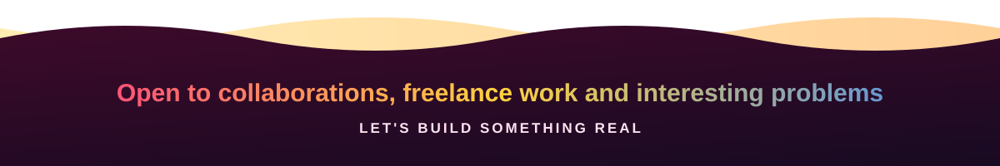

  
    
  
  
  

<h2> About Me</h2>

Yoo Wassup, I'm <b>Syed Umar Ahmad</b>, a Full Stack Developer who builds cross platform mobile apps, modern web frontends, and the backend systems that power them. I care about clean architecture, readable code, and getting products from a rough idea to a stable release without the chaos in between.

<ul>
  <li>📱 Building production <b>Flutter</b> apps powered by Laravel, Node.js, Firebase, and Supabase backends</li>
  <li>⚙️ Designing APIs with <b>Node.js, Express, FastAPI, and Laravel</b></li>
  <li>🔥 Using <b>Firebase and Supabase</b> for auth, realtime data, and storage</li>
  <li>🌐 Shipping responsive web apps with <b>React</b></li>
  <li>☁️ Exploring scalable backend design, containerization, and cloud deployment</li>
  <li>🗂️ Experienced in project planning, team coordination, and delivery tracking</li>
  <li>💬 Ask me about <b>mobile development, API design, or system architecture</b></li>
</ul>

<h2>🛠️ Tech Stack</h2>

  
<b>📱 Mobile</b>

  
  
<b>🎨 Frontend</b>

  
  
<b>⚙️ Backend and BaaS</b>

  
  
<b>🗄️ Databases and Cloud</b>

  
  
<b>🧰 Tools</b>

  

<h2>🧭 How I Work</h2>

<h2>🔥 Featured Projects</h2>

<table>
  <tr>
    <td width="50%" valign="top">
      <h3>🤖 AI Mehdi</h3>
      
AI powered learning platform built with Flutter, delivering personalized educational content.

      
      
      
    </td>
    <td width="50%" valign="top">
      <h3>🛡️ Cyber ShieldAI</h3>
      
Mobile security awareness app that helps users recognize and respond to cyber threats.

      
      
      
    </td>
  </tr>
  <tr>
    <td width="50%" valign="top">
      <h3>🎟️ Eventoury</h3>
      
Web platform for managing events and tourism experiences end to end.

      
      
      
    </td>
    <td width="50%" valign="top">
      <h3>🌱 SustainTipApp</h3>
      
Flutter app encouraging sustainable living through practical, everyday habits.

      
      
    </td>
  </tr>
  <tr>
    <td width="50%" valign="top">
      <h3>🧠 ML DL Fellowship</h3>
      
Notebooks and experiments covering core machine learning and deep learning concepts.

      
      
      
    </td>
    <td width="50%" valign="top">
      <h3>🧰 Utilitia</h3>
      
All in one utility app packed with practical tools for daily use.

      
      
    </td>
  </tr>
</table>

<h2>🎯 Current Focus</h2>

  

  

